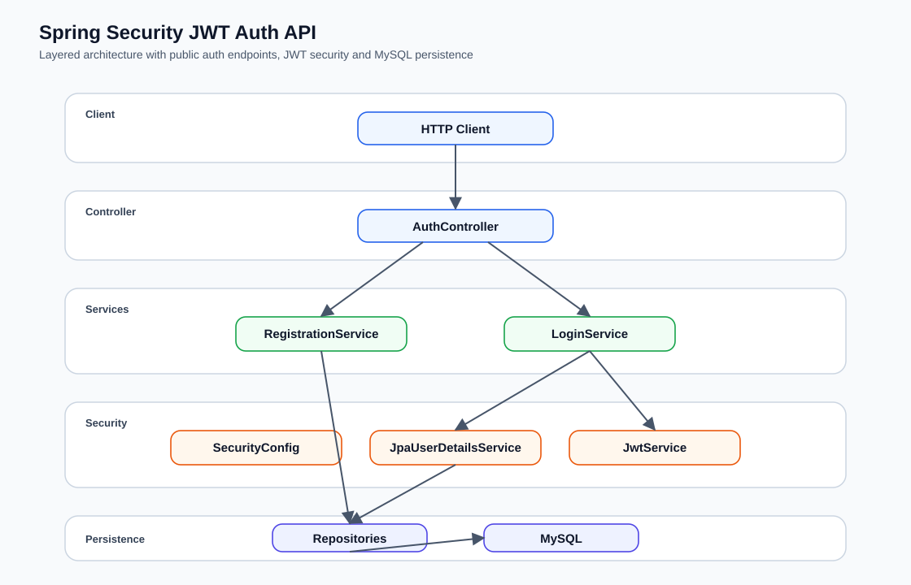
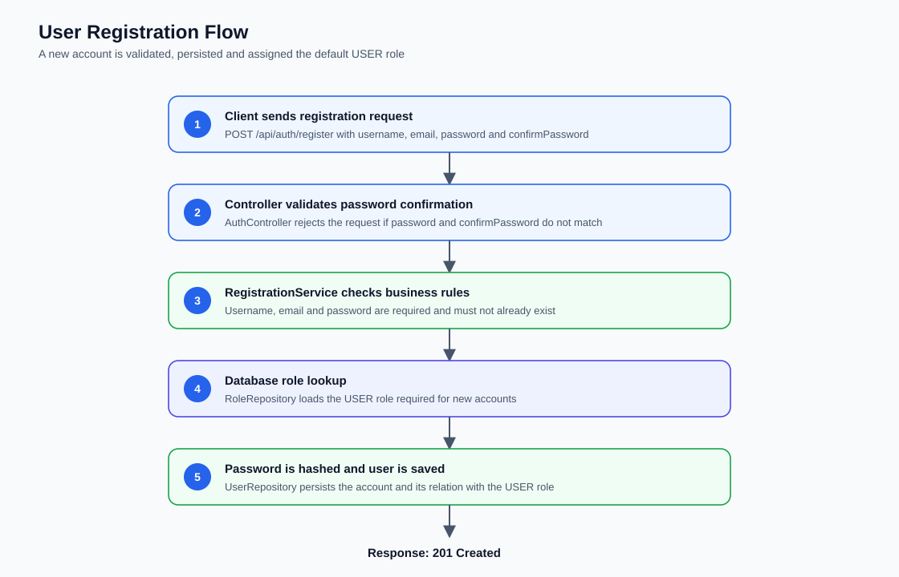
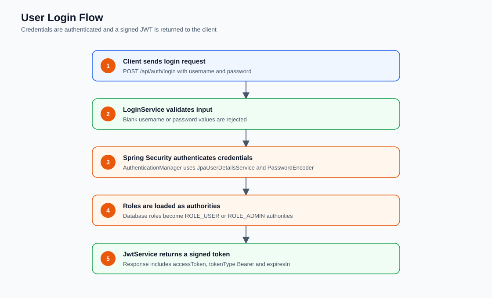
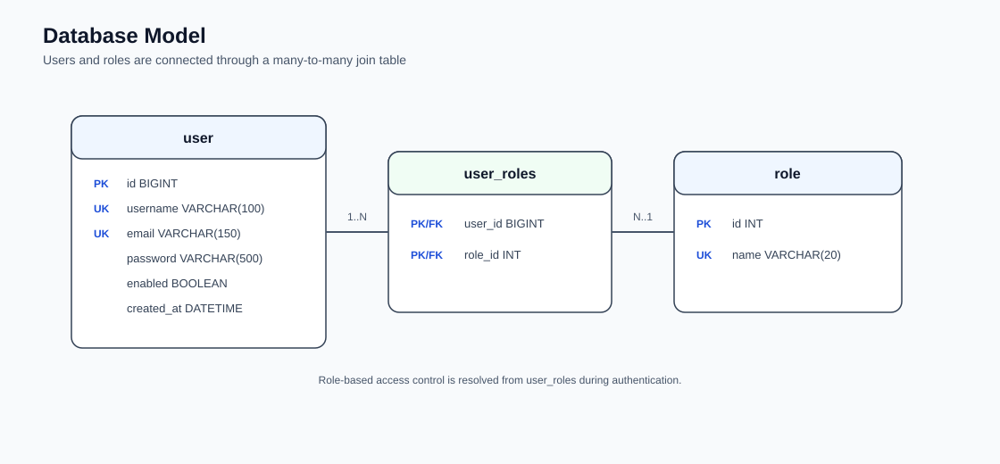

# Spring Security JWT Auth API

A stateless REST API for user registration and login. It issues signed JWT access tokens and enforces role-based access control with Spring Security.


## Purpose

I built this project to understand how the parts of a Spring Security authentication setup fit together: password hashing, the `AuthenticationManager`, a database-backed `UserDetailsService`, token issuing and token validation. It deliberately uses Spring Security's **OAuth2 Resource Server** support to validate tokens, rather than a hand-written JWT filter. My earlier [Task Manager](https://github.com/FranciscoGoal/Task-Manager) project uses a hand-written filter, so the two show different approaches.

## Features

- **Registration.** `POST /api/auth/register` checks for required fields, password confirmation and unique username and email, then assigns the `USER` role.
- **Login.** `POST /api/auth/login` authenticates through the `AuthenticationManager` and returns a signed access token.
- **Password hashing.** Uses `PasswordEncoderFactories.createDelegatingPasswordEncoder()`, which uses bcrypt by default.
- **JWT issuing.** Tokens are HS256-signed with Nimbus `JwtEncoder` and carry `sub` (username), `iss`, `iat`, `exp` and a `roles` claim.
- **JWT validation.** `NimbusJwtDecoder` checks the signature and expiry. A `JwtAuthenticationConverter` maps the `roles` claim to `ROLE_*` authorities.
- **Access rules.** `POST /api/auth/**` is public, `/admin/**` requires `ROLE_ADMIN`, and every other route requires a valid token.
- **Stateless security.** No HTTP session, no form login, and CSRF protection disabled because no cookie-based authentication is used.
- **Secret check.** The application refuses to start if the JWT secret is shorter than 32 bytes.

## Tech stack

| Technology | Role |
| --- | --- |
| Java 21 | Language |
| Spring Boot 4.1 (Web MVC) | Application framework and REST layer |
| Spring Security + OAuth2 Resource Server | Authentication, authorization and JWT validation |
| Spring Data JPA / Hibernate | Persistence |
| MySQL | Database |
| Maven (wrapper included) | Build |

## Architecture

A layered structure: controller → services → repositories. Spring Security configuration is kept in its own package.



```text
src/main/java/com/example/crm
├── controllers/   AuthController: endpoints and exception-to-status mapping
├── services/      RegistrationService, LoginService, JwtService
├── security/      SecurityConfig, JpaUserDetailsService
├── repositories/  UserRepository, RoleRepository
├── models/        User, Role (JPA entities)
└── dtos/          LoginRequest, LoginResponse, RegisterRequest
```

The `crm` package name comes from the original project scaffold.

<details>
<summary><strong>Registration flow, login flow and data model diagrams</strong></summary>







</details>

## Getting started

### Requirements

- Java 21
- MySQL 8 running locally on port 3306

### 1. Configure

The application reads credentials and the signing secret from environment variables:

| Variable | Purpose | Fallback in `application.properties` |
| --- | --- | --- |
| `DB_USERNAME` | MySQL user | `root` |
| `DB_PASSWORD` | MySQL password | `root` |
| `JWT_SECRET` | HS256 signing secret, at least 32 bytes | Development-only placeholder |

```bash
export DB_USERNAME="<your-mysql-user>"
export DB_PASSWORD="<your-mysql-password>"
export JWT_SECRET="<a-random-secret-of-at-least-32-bytes>"
```

The JDBC URL uses `createDatabaseIfNotExist=true`, so the `crm` database is created on first start. Hibernate creates the tables (`ddl-auto=update`). Tokens expire after 60 minutes (`app.jwt.expiration-minutes`).

### 2. Run

```bash
./mvnw spring-boot:run
```

### 3. Seed the roles (required once)

Registration assigns the `USER` role, and roles are **not** seeded automatically. After the first start, run:

```sql
USE crm;
INSERT IGNORE INTO role (name) VALUES ('USER'), ('ADMIN');
```

## API

| Method | Endpoint | Access | Description |
| --- | --- | --- | --- |
| `POST` | `/api/auth/register` | Public | Create an account with the `USER` role |
| `POST` | `/api/auth/login` | Public | Authenticate and receive an access token |

There are **no business endpoints yet**. The `/admin/**` and authenticated-by-default rules are configured so that protected endpoints can be added later.

### Register

```bash
curl -i -X POST http://localhost:8080/api/auth/register \
  -H "Content-Type: application/json" \
  -d '{"username":"jane","email":"jane@example.com","password":"change-me","confirmPassword":"change-me"}'
```

`201 Created`

```json
{ "message": "User registered successfully" }
```

`400 Bad Request` is returned for validation errors, for example:

```json
{ "error": "Passwords do not match" }
```

Other messages: `Username is required`, `Email is required`, `Password is required`, `Username already exists`, `Email already exists`.

### Login

```bash
curl -X POST http://localhost:8080/api/auth/login \
  -H "Content-Type: application/json" \
  -d '{"username":"jane","password":"change-me"}'
```

`200 OK`

```json
{ "accessToken": "<jwt>", "tokenType": "Bearer", "expiresIn": 3600 }
```

`401 Unauthorized` is returned for wrong credentials. The message is the same whether the username or the password is wrong:

```json
{ "error": "Invalid username or password" }
```

### Calling a protected route

Send the token in the `Authorization` header:

```bash
curl -i http://localhost:8080/any/protected/path \
  -H "Authorization: Bearer <jwt>"
```

Without a valid token, every route returns `401` except `POST /api/auth/**` and the static `/css/**` and `/js/**` paths.

## Tests

```bash
./mvnw test
```

The suite currently contains only the Spring Boot context-load test. Because it starts the full application, it needs a reachable MySQL instance.

## Known limitations

- **Roles are not seeded.** If the `USER` role is missing, registration throws an unhandled `IllegalStateException`, which results in a `500` response.
- **Validation is manual.** Request validation is written in the service layer instead of using Bean Validation (`@Valid`, `@Email`, `@Size`). There is no password strength policy.
- **Error handling is local.** Exception handling lives in `AuthController`, not in a global `@RestControllerAdvice`.
- **Access tokens only.** There are no refresh tokens and no revocation.
- **Few tests.** There are no unit or integration tests for the authentication flows, and there is no CI workflow yet.
- **No migrations.** The schema is managed by `ddl-auto=update` instead of Flyway or Liquibase.

## Next steps

1. Seed roles at startup and add a global exception handler.
2. Replace manual checks with Bean Validation.
3. Add `@WebMvcTest` and Testcontainers-based integration tests, then a GitHub Actions workflow.
4. Add a sample protected endpoint and an `/admin` endpoint to demonstrate the access rules end to end.
5. Introduce Flyway migrations and Docker Compose for MySQL.

## Feedback

This is a learning project. Code review and suggestions are welcome through issues.
